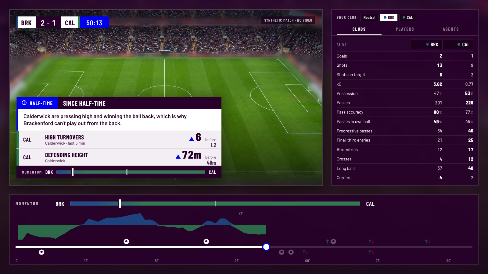

# MatchLens

**Everyone can see when the tide turns. MatchLens shows why.**

MatchLens watches every team and player statistic minute by minute. When a match changes, it finds out where the change came from and puts it on screen as a broadcast graphic: one or two numbers and a momentum bar, with no sentences. The change can follow an event (a red card, a substitution, a goal) or happen with no event at all (tiredness, a duel battle turning, the ordinary ebb and flow).

It is a fresh start for the Microsoft × Premier League hackathon. All match data is synthetic and the clubs are fictional.

## Status

- **Synthetic match generator:** built, and passes the realism gate. A full generated season matches the real 2017-18 Premier League on all 31 numbers checked ([docs/realism.md](docs/realism.md)).
- **Watcher, specialists and Explainer:** built as deterministic tools that work on any match in the public format. Scored against the hidden truth on unseen matches ([docs/explainer.md](docs/explainer.md)).
- **Broadcast screen:** score and clock, an always-on momentum scale, a timeline with the momentum history, and pop-up cards chosen by a Director ([docs/broadcast.md](docs/broadcast.md)).
- **Agents on Microsoft Foundry:** four specialist agents, an Explainer agent and a Verifier share a findings board. Tools compute every number; the models choose; the Verifier rechecks every number against the tables ([docs/agents.md](docs/agents.md)).
- **Next:** a stadium still, then redeploy the live site and record the demo.



```
pip install -e ".[dev]"
matchlens-gen match --home ash --away brk --seed 7   # one match: events, minute tables, physical, hidden truth
matchlens-explain out/matches/ash-brk-7              # the cards that would go on screen
matchlens-broadcast --demo 6 && (cd web && python3 -m http.server 8000)   # the screen, at localhost:8000
matchlens-agents out/matches/ash-brk-7 --runner foundry   # the agent crew on Foundry (pip install -e ".[foundry]")
matchlens-realism                                     # generate 380 matches and check them against the real season
matchlens-explain-eval                                # score the explainer against hidden truth on unseen matches
pytest -q
```

## Docs

- [docs/design.md](docs/design.md): the design, covering the two modes, the agents, the graphic contract, the scoring and the decisions so far.
- [docs/data-format.md](docs/data-format.md): the match format any match can be fed in as.
- [docs/generator.md](docs/generator.md): how the generator works and what the hidden truth holds.
- [docs/broadcast.md](docs/broadcast.md): the broadcast screen, its controls and the Director.
- [docs/explainer.md](docs/explainer.md): the Watcher, the specialists and the Explainer, what stats can and can't tell you, and how well it scores.
- [docs/agents.md](docs/agents.md): the agent crew on Microsoft Foundry, the shared findings board and the Verifier.
- [docs/research/](docs/research/): which football stats exist and what each one reveals, plus what 380 real matches show about momentum shifts.

## Build order

1. ~~Synthetic match generator, gated on a realism test against the real-season patterns.~~ Done.
2. ~~A watcher that spots shifts, plus specialists that investigate them.~~ Done.
3. ~~Broadcast graphics: a momentum scale, an event timeline, and the event, spontaneous and recovery cards.~~ Done, apart from the stadium still.
4. ~~Specialists as Foundry agents, with an LLM Explainer and a Verifier.~~ Done.

## Research data

`research/` holds the scripts that measured the real-season patterns, and `learn_priors.py`, which turns that season into the generator's aggregate tables (`matchlens/gen/priors.json.gz`). They read the public Wyscout event dataset (Pappalardo et al., 2019, *Scientific Data* 6:236, [figshare](https://doi.org/10.6084/m9.figshare.c.4415000), CC BY 4.0). That data is downloaded on demand to measure patterns only. None of it is committed or shipped.

## Licence

MIT. See [LICENSE](LICENSE).
