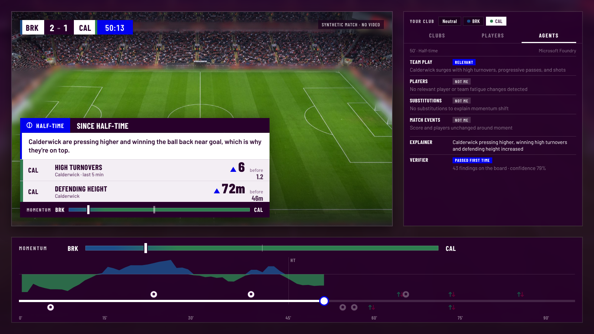

# The agents



The Watcher, the specialists and the Explainer ([explainer.md](explainer.md)) also run as a crew of agents on Microsoft Foundry. The models reason, compare and choose. Tools compute every number, and a Verifier written in code checks every choice. The deterministic Explainer is still there as the fallback, and as the offline stand-in for the models.

```
pip install -e ".[foundry]"
az login
export AZURE_AI_PROJECT_ENDPOINT=https://<resource>.services.ai.azure.com/api/projects/<project>
matchlens-agents out/matches/ash-brk-7 --runner foundry           # the cards, with each agent's reasoning
matchlens-broadcast --demo 6 --agents foundry                     # bundles for the screen, explained by the agents
matchlens-explain-eval --matches 30 --agents foundry              # score the crew against hidden truth
```

`AZURE_AI_MODEL` picks the model deployment (default `gpt-4.1-mini`). Sign-in is Microsoft Entra ID through `DefaultAzureCredential`, so no key is stored anywhere. Without the `foundry` extra, or with `--runner offline`, the same crew runs on the deterministic rules.

## Who does what

For each moment the Watcher raises (a shift, a recovery or an event):

| Agent | Foundry agent | Tool | Job |
|---|---|---|---|
| **Team-play analyst** | `matchlens-team-play` | `investigate_team_play` | How each team's play changed since the anchor. |
| **Player analyst** | `matchlens-players` | `investigate_players` | Which players changed most, and team-wide fatigue. |
| **Substitutions analyst** | `matchlens-substitutions` | `investigate_substitutions` | Each recent substitute against the player he replaced. |
| **Match-events analyst** | `matchlens-match-events` | `investigate_match_events` | Goals, red cards and game state. |
| **Explainer** | `matchlens-explainer` | `check_card` | Chooses the cause and the one or two numbers that show it. |
| **Verifier** | (code) | | Recomputes every number from the tables and enforces the screen rules. |
| **Interpreter** | `matchlens-interpreter` | | Says what the card's numbers mean for the game, in one line for each viewer. |
| **Analyst** | `matchlens-analyst` | | Says what each club could do about the momentum, picked from options a stat backs. |

1. **The four specialists run at the same time.** Each one calls its tool. The tool computes findings from the match tables and posts them to the shared findings board, each with an id (F1, F2, ...). The specialist then says which of its findings matter, or "not me".
2. **The Explainer reads the board.** It also gets a story menu: pairs of findings that together say how a team's play changed (see [explainer.md](explainer.md)), and a cause menu: only the causes the evidence allows for this moment. For example, a goal can be followed by "the scorers kept pushing", "the other side chased the game" or "no reaction". It picks a cause and up to two finding ids, then calls `check_card` to test its draft before answering.
3. **The Verifier checks the final draft.** It runs the specialists again on the tables, independently of what was posted, and compares every number. It also checks the screen rules:
   - a number must be big enough to see;
   - no metric appears twice;
   - a player's number appears only when the card is about him;
   - a "10 men reshaped" claim needs a stat that shows it;
   - a share such as possession can't go on a card alone when a stat that moved with it is on the board.

   A rejected draft goes back to the Explainer once, with the problems listed. A second rejection, or an Explainer that fails, falls back to the deterministic choice.

4. **The Interpreter reads the verified card** (for the cards the Director puts on screen). It gets the facts: the clubs, the score and minute, which side momentum moved to, the cause, the stats with before and after, and a draft reading from the rules (`matchlens/explain/insight.py`). It writes one line for a neutral and one for each club's fans, saying what is going on rather than reading the stats out. For example, more final-third passes and box entries from a side that is a goal down becomes "Brackenford have gone on the attack, looking for a way back into the game". A check in code holds each line to the facts:
   - no numbers (the card shows them);
   - only the two clubs and the players on the card;
   - nothing the data can't see: a manager's instructions, injuries, the referee or the crowd;
   - tiredness only on a fatigue or substitution card, and ten men only on a red-card card;
   - talk of an equaliser or a lead only when the score allows it.

   When the card is about a player, the line says how his stat moves the game, not just that he is doing more of it: what it gives his club and what it does to the other side. "Off the bench, Cromton's aggressive running is giving Brackenford more attacking options and putting Calderwick under pressure", not "Cromton is sprinting more". Each player stat in the facts carries a plain meaning to build on.

   A rejected draft goes back once with the problems listed. After that, the card keeps the rules' lines.

5. **The Analyst gives the debate** (at the same time as the Interpreter, for the cards on screen). When the card leaves, a MatchLens analysis card follows: what the side that lost momentum could do to win it back, or what the side that has it should keep doing. The Analyst can only pick from a menu of levers, built in `matchlens/explain/analysis.py`, and each lever is there only because a stat backs it:
   - "push the line back up" needs that side's defending height to have dropped;
   - "stop going long" needs its long balls or pass length up;
   - "play through their press" needs the other side's high turnovers up;
   - "keep going down the flanks" needs the side's crosses up; and so on, 18 levers in all.

   It picks one lever per club and writes one line for each viewer: a fan hears about their own club, and a neutral about the side that lost momentum. The lever's stat goes on the card under the line. A check in code holds the lines to the picks:
   - each pick is a real option for that club;
   - each line names its club and argues its pick's idea;
   - no other change that its stat doesn't back (a higher line, pressing, going long, going wide);
   - no numbers, no players, nothing the data can't see (the manager, a formation, a substitution to make, the referee);
   - talk of an equaliser, a lead or ten men only when the match allows it.

   A rejected draft goes back once; after that, the card keeps the rules' picks and lines.

The models only ever refer to numbers by id. The card is built from the board, so the number on screen is the number the tool computed. A model cannot change a number by retyping it.

**When an agent fails.** A specialist that fails or times out leaves its findings off the board. The Explainer works with what is there, and the card's confidence drops by 0.1 for each missing specialist. Every step is logged on the card under `agents`: each specialist's verdict and note, the Explainer's reason, and each Verifier round. The screen shows this log in the Agents tab of its stats panel (press U).

**On Foundry.** Each role is published once to the project's Agent Service as a prompt agent, with its instructions, model and tool declarations. A new version is published only when the definition changes. Tasks run as those agents through Microsoft Agent Framework (`FoundryAgent`). The tools run in the pipeline, on the match tables.

## The shared board

One record per finding, as in [design.md](design.md) section 5:

```json
{"id": "F7", "agent": "team_play", "claim_type": "team_change", "team": "brk", "metric": "possession",
 "label": "Possession", "before": 41.2, "after": 63.0, "unit": "%", "effect_sd": 2.8, "minutes": 9, "polarity": 1}
```

`effect_sd` measures how unusual the change is against random windows of the same match. `polarity` says whether more of the stat means more control for that team.

## How it scores

On 30 unseen matches (season seed 9000), scored against the generator's hidden truth the same way as [explainer.md](explainer.md):

| | Deterministic Explainer | Agents on Foundry (gpt-4.1-mini) |
|---|---|---|
| Cards per match (before the Director) | 12.2 | 12.2 |
| Shifts matching a hidden swing (random windows: 69%) | 81% | 81% |
| Event shifts backed by a real decision | 84% | 84% |
| Checked cause claims correct | 71% (49 claims) | 70% (43 claims) |
| Cards that fell back to the rules | | 3.6% |
| Model calls, tokens | | 1,826 calls, 3.1M in, 110k out (about $1.40 in all, 5 cents a match) |

The Watcher is the same code in both columns, so the first three rows match by construction. The test is the claims, and the agents hold the same accuracy while making their own choices:
- They call a substitute's impact less often (47 cards against 77) and say the change made no visible difference more often (66 against 38).
- They put fewer cards down to fatigue (14 against 20), at about the same accuracy (79% against 80%).

The truth can't score substitution claims yet, so it can't say whether the agents' extra caution there is right.

Run it with `matchlens-explain-eval --matches 30 --agents foundry`. CI runs the offline crew only, which gives the same cards as the deterministic Explainer.

## Tracing

Every Foundry run is traced with OpenTelemetry into the Application Insights resource linked to the Foundry project, so each run shows up on the Foundry portal's **Tracing** page with no setup. One match is one trace. The code steps are spans of their own: the Watcher, each moment, each specialist, each Explainer round, the Verifier's check and any fallback. The agents' own calls (`invoke_agent`, `chat`, `execute_tool`) come from Microsoft Agent Framework and sit underneath them. That makes it easy to see which agent was slow, which draft the Verifier rejected and why, and what each call cost in tokens.

The connection string comes from `APPLICATIONINSIGHTS_CONNECTION_STRING`, or failing that from the project. `MATCHLENS_TRACING=off` turns tracing off, and `MATCHLENS_TRACE_CONTENT=0` leaves prompts and replies out of the traces. The code is in `matchlens/telemetry.py`. The offline runner and CI use the same spans as no-ops.

## Code

- `matchlens/agents/board.py`: the findings board.
- `matchlens/agents/roles.py`: each agent's instructions.
- `matchlens/agents/verifier.py`: the cause menu and the Verifier.
- `matchlens/agents/crew.py`: the crew, and `matchlens-agents`.
- `matchlens/agents/runners.py`: the Foundry and offline runners.
- `matchlens/telemetry.py`: tracing to Application Insights.

Tests in `tests/test_agents.py` cover the following:
- the offline crew gives the same cards as the deterministic Explainer;
- a rejected draft goes back once and then falls back;
- a fixed draft passes on its second round;
- a failed specialist lowers confidence;
- the Verifier catches a number that no longer matches the tables.

`tests/test_telemetry.py` checks that a match is a single trace, with every moment, specialist and Verifier check in its place.
