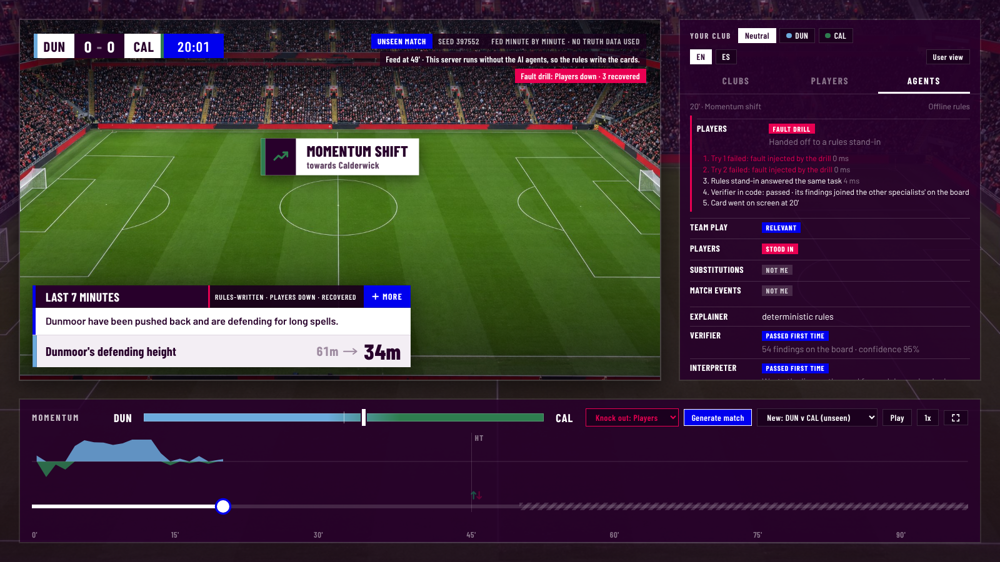

# Generate match: an unseen match, live on the site

The live site plays six prebuilt demo matches. **Generate match** (on the admin screen, `?mode=admin`, or the G key there) makes a brand-new
one and plays it through the whole pipeline while you watch, so the unseen-match path
([live-feed.md](live-feed.md)) can be seen working rather than taken on trust.

```
press Generate match ──► POST /api/generate
                          │  random seed (100000-999999) and a random pairing of the 20 fictional clubs
                          ▼
                     generator ──► match folder + hidden truth
                          │  written as a provider's feed: per-minute club and player tables and
                          │  key events, no final score, no seed. The folder and truth are deleted.
                          ▼
                     LiveRunner, one minute at a time (a minute every 0.5 s)
                          │  Watcher.step → crew (4 specialists + Explainer + Verifier) → Director
                          │  → Interpreter and Analyst on the cards going up
                          ▼
                     the screen's bundle, rebuilt from the minutes so far ──► GET /api/live/<id>
                                                                                │  polled every 1.5 s
                                                                                ▼
                                                                         web/live.js → app.js
```

The screen's clock never passes the last minute the feed has sent; the striped part of the timeline
is what hasn't arrived yet. If the clock catches up (4x speed, or a slow moment on Foundry), the
badge says the agents are working on that minute and the clock waits. The badge on the feed shows
the seed and that no truth data was used. At full time the Recapper writes the recap headlines and
the Translator the Spanish lines.

## What keeps it cheap and the page whole

| | |
|---|---|
| **Daily budget** | `SWING_DAILY_AI_MATCHES` (5) matches a day are explained by the agents on Foundry, within `SWING_DAILY_MODEL_CALLS` (850) model calls. A match takes about 65 calls for the cards, plus a few for the recap and Spanish. The count is kept in `SWING_STATE_DIR` and resets at midnight UTC. |
| **Past the budget** | The match is still generated and played; the deterministic rules write the cards, and the screen says so. |
| **One at a time** | One match on the agents at a time; a second viewer's match gets the rules. At most three matches play at once. |
| **Per visitor** | `SWING_GENERATE_PER_HOUR` (6) new matches an hour from one address. |
| **One agent fails** | That call is tried once more, then a rules stand-in answers the same task and the chain carries on: its findings go on the board beside the other specialists', and its draft or lines still go through the Verifier or the line check in code. The card says which agent was recovered, and the Agents tab shows each try ([failover.py](../swing/live/failover.py)). |
| **Foundry slow or down** | The app checks it can sign in before the first minute. A moment that takes over 45 s, or any failure, hands that card and the rest of the match to the rules, labelled "Rules-written" on the card. |
| **Server gone** | A plain static copy of web/ hides the button; the demo matches always play. |

## The fault drill: recovery on screen

The admin screen has a **Fault drill** list beside Generate match. Pick an agent (a specialist, the
Explainer, the Interpreter or the Analyst) and the next generated match runs with that agent failing
every call (**Knock out**) or only its first try at each task (**Flaky**). For the demo video,
`?mode=admin&tab=agents&drill=explainer` (add `&drill_mode=flaky` for the retry) arms it from the URL.

What it shows, card by card: which agent failed and each try, the retry or the hand-off to the rules
stand-in, the check in code the answer then passed, and the card going up on time. The card itself
carries a small label ("Players down · recovered"), and the badge on the feed counts the recoveries.



The fault is injected in the server before the call leaves it, so a drill costs no model calls and
touches no other viewer's match. It is asked for with `POST /api/generate?drill=<agent>&drill_mode=down|flaky`,
checked against the list of the card's agents, and limited to `SWING_DRILLS_PER_HOUR` (3) an hour
per visitor on top of the usual limit. `SWING_DRILLS=off` switches it off. It needs no key.

## Running it

```
swing-live --web web --agents offline     # no Azure: the rules explain every match
swing-live --web web                      # agents on Foundry when AZURE_AI_PROJECT_ENDPOINT is set
```

On Azure Container Apps the app signs in with its managed identity, which needs the **Azure AI
User** role on the Foundry account (`infra/main.bicep` grants it). The deploy workflow sets the
endpoint and the budget on the app.
